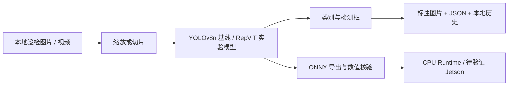

# 桥观 · Bridge Edge Vision

**面向桥梁表观病害的本地视觉检测工程。** 从公开桥梁巡检数据，到可追踪训练、图片/视频推理、ONNX 部署和本地检测界面，形成可复现的第一版研究原型。

当前覆盖：**裂缝、混凝土剥落、露筋、锈蚀/锈迹、蜂窝麻面**。图片推理不依赖云端 API；本版本不加载视觉语言大模型。

> 研究状态：v0.1 工程与预实验。完整实验数据见 `artifacts/experiments/pilot_results.json`（运行预实验后生成）。预实验不等于论文最终结果，也不构成结构安全鉴定。

<!-- experiment-status:start -->
当前进度：固定 **766 训练 / 160 验证图**，CPU YOLOv8n 已完成 15 轮（mAP50 **0.0793**，mAP50–95 **0.0319**）。RepViT 与多尺度模块的完整对照正在执行，尚未发布其最终结果。
<!-- experiment-status:end -->

## 可以做什么

| 能力 | 实现 |
|---|---|
| 本地图片检测 | 五类候选位置、类别、置信度、标注图与 JSON |
| 高分辨率图片 | 滑窗切片、坐标还原、按类别合并 NMS |
| 图片文件夹 / 视频 | 批量处理；视频按间隔采样；摄像头入口需实物验证 |
| 检测工作台 | 本机图片上传、模型选择、阈值调整、历史记录与结果导出 |
| 可复现实验 | 固定数据版本、原始划分、种子、数据与权重哈希、训练记录 |
| 检测器对照 | YOLOv8n、RepViT + YOLO 检测头、增加自适应多尺度模块的版本 |
| 部署 | PyTorch CUDA / CPU；ONNX 导出、数值对比与 CPU Runtime |
| 边缘端研究 | 记录当前设备真实时延；Jetson/TensorRT 保留实机验证路线 |



## 快速开始

使用 Python 3.12。本项目独立组织代码、数据与运行环境，具体软件版本和长训练验证以实验记录为准。PyCharm 选择本项目的 Python 解释器后运行 `main.py`；Windows 启动脚本会读取本机未跟踪的 `.local/settings.json`。

新环境可使用 [uv](https://docs.astral.sh/uv/)：

```powershell
uv python install 3.12
uv sync
uv run bridge-edge doctor
```

也可在已安装依赖的解释器中直接运行：

```powershell
python main.py doctor
```

默认依赖指向官方 PyTorch CPU 索引。开发机的两套 CUDA 环境均未通过长训练稳定性验证，因此第一版正式采用 CPU 训练与 ONNX CPU 部署。GPU 实验可另建环境安装 `requirements-cuda.txt`，但必须重新验收，不能把“能识别显卡”写成训练已稳定。Jetson ARM64 应使用对应 JetPack 的运行时，不能套用 Windows 虚拟环境。

只用 CPU 时，可在 Python 3.12 虚拟环境中执行 `python -m pip install -r requirements-cpu.txt`，再运行 `python scripts/run_pilot.py --device cpu`。该入口固定官方 CPU 版 Torch，避免下载 CUDA 运行时。

### 1. 获取并准备真实数据

```powershell
python main.py data download --train-limit 768 --val-limit 160 --workers 8
python main.py data prepare --profile pilot
python main.py data audit --profile pilot
```

输出：原始图片、下载来源与哈希、YOLO 标注、数据清单、类别统计和审计结果。

默认数据目录为工程 `data/`。可用环境变量 `BRIDGE_EDGE_WORKSPACE` 或未跟踪的 `.local/settings.json` 指向容量更大的磁盘。本开发机的实际数据与权重保存在 D 盘，避免占用系统盘。

下载器保留原始 `train` / `validation` 标签，按固定 SHA256 排序选图，不将官方 `testdev` 当作有标签训练集。`--train-limit 0 --val-limit 0` 会获取镜像中的全部有标注训练/验证图；使用新的 `full` 数据 profile 准备，避免覆盖既有实验。

### 2. 下载初始权重并训练

本开发机已缓存官方 YOLOv8n 与 RepViT ImageNet 初始权重。新环境先运行：

```powershell
python scripts/download_weights.py
python main.py train --config experiments/pilot-yolov8n.yaml
python main.py train --config experiments/pilot-repvit.yaml
python main.py train --config experiments/pilot-repvit-amsf.yaml
```

一次运行完整预实验、导出与测速：

```powershell
python scripts/run_pilot.py
```

每次训练创建新的 run，保存配置、数据清单哈希、初始化验证、逐轮日志、真实验证指标与权重。既有实验不会被同名训练覆盖。

### 3. 打开本地检测界面

```powershell
python main.py serve
```

浏览器访问 **http://127.0.0.1:8765**。选择本机图片或固定验证集样例，点击“开始检测”。模型未训练时会明确显示未就绪。

Windows 已配置环境也可运行 `./run.ps1`；PyCharm 提供 `Local UI` 运行配置。详细操作与验收见[第一次运行指南](docs/QUICKSTART_ZH.md)，本地接口见[API 文档](docs/API.md)，边缘实机步骤见[Jetson 路线](docs/JETSON.md)。

```powershell
python main.py predict --source path/to/image.jpg
python main.py predict --source path/to/images --tile-size 768
python main.py video --source path/to/video.mp4 --every 5 --max-frames 300
```

### 4. 导出与测量

```powershell
python main.py export --weights path/to/best.pt --sample path/to/image.jpg
python main.py benchmark --weights path/to/best.pt --source path/to/image.jpg --device 0
python main.py benchmark --weights path/to/best.onnx --source path/to/image.jpg --device cpu
```

报告包含设备、精度、输入尺寸、预热次数、p50/p95 和平均耗时。当前电脑的速度不作为 Jetson 速度；ONNX 数值一致也不等于 TensorRT/INT8 实机通过。

## 数据来源与许可

数据从 [dacl10k 维护者 GitHub](https://github.com/phiyodr/dacl10k-toolkit)发现，使用其生态中的 [Voxel51/dacl10k 镜像](https://huggingface.co/datasets/Voxel51/dacl10k)，固定到 `configs/sources.json` 的不可变版本。

- 原始任务是多标签语义分割。镜像提供的 `od_ground_truth` 是由多边形得到的包围框；本项目的检测指标属于转换后的五类子任务，不能直接与原论文分割 mIoU 比较。
- 上游 README 与镜像 `metadata.json` 标注 **CC BY-NC 4.0**，镜像 README 的 BY-4.0 存在冲突。本项目按更严格的上游非商业许可处理。数据、权重和用户上传图片均不随代码仓库发布。
- 详见 [数据说明](docs/DATASET_CARD.md)、[第三方许可](THIRD_PARTY_NOTICES.md)及 [研究方案](docs/RESEARCH_PLAN.md)。

## 工程结构

```text
configs/                  数据来源、网络结构、实验参数
src/bridge_edge/data/     下载、转换、划分与审计
src/bridge_edge/models/   RepViT 与多尺度实验模块
src/bridge_edge/runtime/  PyTorch / ONNX、切片、NMS
src/bridge_edge/web/      无外部 CDN 的本地检测界面
src/bridge_edge/server.py 本地 HTTP API
scripts/                 初始权重、完整预实验与验收
tests/                   几何、数据、安全路径和 API 合约测试
artifacts/experiments/    可公开的真实预实验记录
docs/                    数据卡、实验协议、Jetson 路线和初学者指南
```

运行测试：`python -m unittest discover -s tests -v`。GitHub Actions 只跑轻量 CPU 单元和 HTTP 合约；GPU 训练与部署验收由本地真实运行记录提供。

## 范围与后续工作

第一版不涉及结构位移量推算、毫米级尺寸测量、钢桥焊缝专用识别、无人机控制或云端大模型。后续按 [研究路线](docs/RESEARCH_PLAN.md)完成全量多种子实验、跨桥梁验证、标定测量和 Jetson 实机比较。

源代码使用 **AGPL-3.0-only**。数据与第三方初始权重分别保留其原有许可。引用见 `CITATION.cff` 和 `docs/references.bib`。
