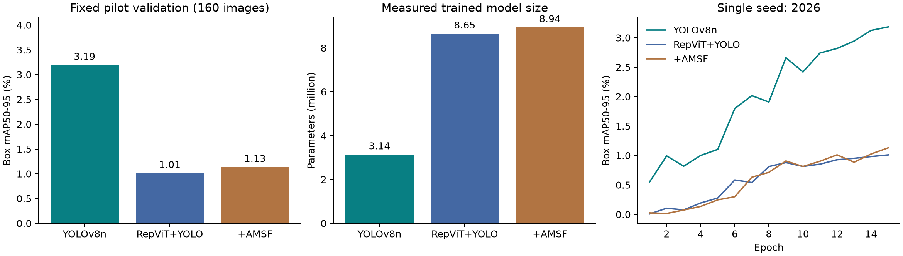

# 第一版模型卡与实测结果

固定 766 训练 / 160 验证图，输入 384，15 轮，seed 2026。单种子预实验，未评估独立测试集。

| 模型 | 参数量 | mAP50 (0–1) | mAP50-95 (0–1) | 训练完成轮数 |
|---|---:|---:|---:|---:|
| yolov8n | 3,138,975 | 0.0793 | 0.0319 | 15 |
| repvit | 8,648,159 | 0.0381 | 0.0101 | 15 |
| repvit-amsf | 8,938,047 | 0.0430 | 0.0113 | 15 |

网页默认模型：`pilot-yolov8n-s2026-r9`，按本预实验验证集 mAP50-95 选择，未据此声称独立测试泛化能力。

## 部署实测

| 后端 / 设备 | p50 (ms) | p95 (ms) | 平均 (ms) |
|---|---:|---:|---:|
| pytorch / CPU | 20.45 | 30.24 | 21.80 |
| onnx / CPU / ONNX Runtime | 16.63 | 18.67 | 16.98 |

测速包含预处理、推理和 NMS，排除图片解码、模型加载、标注保存与 HTTP/相机采集；初始化后 5 次预热、30 次计时、batch 1、FP32。此处没有 Jetson 或 TensorRT 实测。

验证证据：[HTTP、切片、视频采样与后端一致性](../artifacts/experiments/acceptance.json)、[PyTorch 离线进程](../artifacts/experiments/offline-pytorch.json)、[ONNX 离线进程](../artifacts/experiments/offline-onnx.json)、[无 PyTorch 的安装包推理](../artifacts/experiments/edge-wheel-onnx.json)。

## 使用边界

五类图像可见病害候选；不输出病害深度、毫米尺寸、结构承载力或安全等级。
当前检测精度较低，本轮用于建立可复核的工程基线；需要扩充训练与独立数据验证后再评价实用效果。
数据框来自分割多边形，类别不平衡，拍摄标记与修补痕迹可能造成捷径学习。应补充多种子、跨桥梁/跨来源和独立采集验证。
YOLOv8n 使用 COCO 检测预训练，RepViT 使用 ImageNet 骨干初始化，因此二者比较包含初始化差异；RepViT 与 +AMSF 的共享参数已对齐，用于模块消融。
三组数据与训练预算相同，CUDA 调度设置记录在 JSON 中；训练耗时不作为严格速度对照，部署时延另行测量。
多尺度模块是否有益以数值为准；本项目没有证明论文创新性。源码 AGPL-3.0-only；数据遵守 CC BY-NC 4.0，模型权重不随源码公开。
